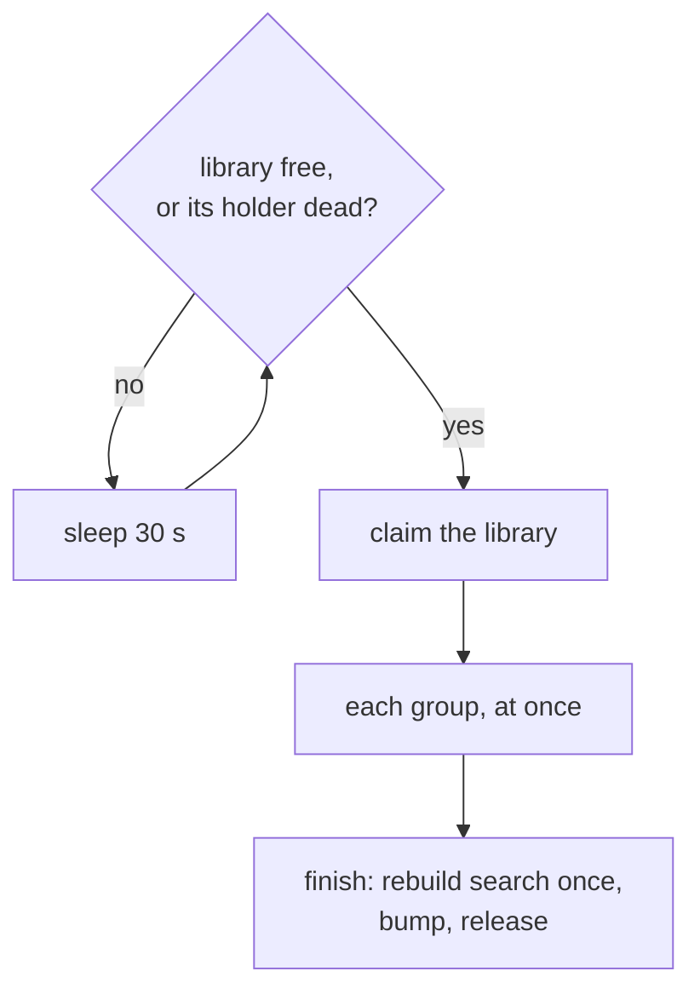

# Loading

## Purpose

A library is a set of groups, each pinned to a version of one Onshape document,
whose tabs are its insertables. Loading reads a document's latest version from
Onshape and writes everything the app shows about it: the group, each
insertable's metadata, configurations and records, thumbnails, build issues, and
the library's search index.

A reload is one Cloudflare Workflow per request, covering the library's groups or
the few it names, so it can take minutes, survive retries, and resume where it
stopped. One reload holds a library at a time.

## Code map

| Path                                                            | Role                                                         |
| --------------------------------------------------------------- | ------------------------------------------------------------ |
| `src/backend/features/load/jobs.ts`                             | `requestReload`, the library's claim and job status, in KV   |
| `src/backend/features/load/holds.ts`                            | Holding or loading a new version, releasing, approving       |
| `src/backend/features/load/workflows.ts`                        | `ReloadLibraryWorkflow`: claim, load each group, finish      |
| `src/backend/features/load/load-group.ts`                       | `loadGroup`: contents, which tabs to load, save, cleanup     |
| `src/backend/features/load/load-insertable.ts`                  | `loadInsertable`: probe one tab, its thumbnail, save its row |
| `src/backend/features/load/context.ts`                          | `LoadContext`, limiters, `getOnshapeApiFromContext`          |
| `src/backend/features/load/steps.ts`                            | Retry policies for Onshape steps and thumbnail steps         |
| `src/backend/features/load/flag.ts`                             | `flagFailedLoads`, for loads that died without saying so     |
| `src/backend/features/load/routes.ts`                           | Reload and approve endpoints                                 |
| `src/backend/features/load/parse-*.ts`                          | Onshape responses to what we store                           |
| `src/backend/features/library/groups/routes.ts`                 | Adding a document (shell group + load) and deleting a group  |
| `src/backend/features/webhooks/`                                | The per-document webhook that reports new versions           |
| `src/backend/features/push/`                                    | Pushes job status and library changes to open clients        |
| `src/frontend/features/library/components/reload-button.tsx`    | **Reload** (outdated) and the owner's **Reload all**         |
| `src/frontend/features/library/components/version-approval.tsx` | **Hold new versions**, **Held versions**, and approving them |

## Storage

**D1**

- `groups`, `insertables`, `configurations` — what a load writes.
  `groups.version_id` is the version loaded; a shell group holds
  `PLACEHOLDER_VERSION_ID` until its first load.
- `libraries.cache_version` — bumped by every load that wrote; every library
  response is cached under it.
- `groups.held_at` — when a webhook last reported a version not yet loaded;
  null when nothing is held. Set by the webhook, cleared by a load.
- `libraries.hold_new_versions` — whether a new version waits for approval;
  on unless an admin turns it off.
- `onshape_webhooks` — one row per document: its webhook id and delivery token.

**R2**: `search-index/` — each library's serialized search index, rebuilt by
every reload that wrote. Thumbnails are in [thumbnails.md](./thumbnails.md).

**KV** — load state, which is ephemeral; the tables above hold only what a load
wrote.

- `library-reload:{libraryId}` — the reload holding the library: its instance,
  when it started, and the groups it has still to finish. A day, as a backstop.
- `library-reload-queued:{libraryId}:{instanceId}` — a reload waiting for its
  turn, with its groups. A day, as a backstop.
- `background-session:` — sessions a load with no requester can borrow; see
  [auth.md](./auth.md).

## Flows

### Starting reloads

Four things call `requestReload`, each naming the groups to load; all but the
webhook pass their requester's session:

- **Adding a document** writes a shell group first, flagged `NOT_LOADED`, so a
  first load that fails or never starts still leaves something to retry or
  delete, then reloads it. The load's save clears the flag; a failure replaces
  it with `LOAD_FAILED`.
- **Reload** (editor): every group of the library; each skips itself when its
  version is unchanged and it has no failure. **Reload all** (owner) forces
  every group, which spends a lot of the Onshape allocation. Either loads any
  held version too, which releases its hold.
- **Approve** (editor) reloads the library's held groups; see
  [Version approval](#version-approval).
- **A webhook for a new version** reloads the document's group in a library
  that doesn't hold new versions, and only holds it in the rest; see
  [Version approval](#version-approval).

`requestReload` marks the reload queued, so its groups show as loading at once,
creates the instance and pushes the library's job status.

### One reload

Each group runs under its own step names (`prefixSteps`, `{group}-`), sharing
the reload's limiters:

1. Reads the group row, and resolves the document and its latest version.
2. Skips the group when its version is unchanged, it isn't forced and its last
   load didn't fail, releasing a hold it still carries; otherwise runs
   `loadGroup`. A failure flags it `LOAD_FAILED` and the rest carry on.
3. Makes sure the document's webhook exists.
4. Records the group done, so the job status counts down.

`loadGroup`:

1. Reads the document's contents and the group's stored insertables. A tab
   whose name contains "deprecated", in any case, or any tab inside a folder
   so named, is dropped from the contents (`withoutDeprecated`), so everything
   after treats it as deleted.
2. Selects tabs to load: new ones, changed ones (microversion differs), ones
   whose last load failed, or all when forced. Removed and reordered tabs are
   computed from the same lists.
3. Loads each selected tab (`loadInsertable`) in parallel under the reload's
   limiter (`LOAD_CONCURRENCY`, 30, shared by every group). A tab that fails is
   recorded and the rest carry on.
4. Stores the group's thumbnail, then saves the group in one step: its fields,
   removals, new order, and the group checks (`checkGroup`), among them
   `INSERTABLES_FAILED` if any tab failed. A save with no failed tab releases
   the group's hold.
5. Deletes stale thumbnails, which is never fatal.

Every build issue is stored. The one that depends on an editor's choice,
`NO_UNHIDDEN_INSERTABLES`, is checked by the save and again whenever an editor
shows or hides elements (`recheckVisibility`), which skips a group with no
insertables.

`loadInsertable`: probes the tab under the limiter (configuration, parts, fasten
info, vendors, and a record per indexed combination), fetches its thumbnail
under the thumbnail limiter, runs the insertable checks, and saves the row.

`finishReload` always runs, success or not: when anything was written it
rebuilds the search index, then bumps the library version and pushes; then it
releases the library **only if this reload still holds it**.

### Steps, Onshape calls and retries

Each row is one durable workflow step, named as in the dashboard; a step's
result is stored, so a retried or resumed reload skips steps that finished. A
group's steps carry its id in front (`{group}-document`). The reload's own are
`claim-{n}` and `wait-{n}` until it holds the library, and `finish`. One reload can run every group of a large
library, so the workflow's step limit is raised to 25,000.
`ONSHAPE` is `ONSHAPE_STEP_RETRIES`, `THUMBNAIL` is `THUMBNAIL_RETRIES` (see
[platform.md](./platform.md#retries-and-timeouts)).

| Step                                                       | Onshape call                                                                                            | Retries     |
| ---------------------------------------------------------- | ------------------------------------------------------------------------------------------------------- | ----------- |
| `read-group`                                               | —                                                                                                       | default     |
| `document`                                                 | `GET /documents/{did}`                                                                                  | `ONSHAPE`   |
| `version`                                                  | `GET /documents/d/{did}/versions` (the latest), and when it was read                                    | `ONSHAPE`   |
| `release-hold` (skipped and held)                          | —                                                                                                       | default     |
| `document-contents-{group}`                                | `GET /documents/d/{did}/v/{vid}/contents`                                                               | `ONSHAPE`   |
| `stored-insertables-{group}`, `select-insertables-{group}` | —                                                                                                       | default     |
| `flags-{insertable}`                                       | —                                                                                                       | default     |
| `config-{insertable}`                                      | `GET /elements/d/{did}/v/{vid}/e/{eid}/configuration`                                                   | `ONSHAPE`   |
| `parts-{insertable}` (part studios)                        | `GET /parts/d/{did}/v/{vid}/e/{eid}`                                                                    | `ONSHAPE`   |
| `fasten-{insertable}` (if enabled)                         | Assembly definition, or part studio features                                                            | `ONSHAPE`   |
| `records-{insertable}-{batch}`                             | Per configuration: `GET /parts/...` (part studio) or `GET /metadata/...` (assembly), with the overrides | `ONSHAPE`   |
| `thumbnail-{insertable}`                                   | `GET /thumbnails/d/{did}/v/{vid}/e/{eid}/s/{size}`, then `/w/{wid}/` on failure, both sizes             | `THUMBNAIL` |
| `save-{insertable}`                                        | —                                                                                                       | default     |
| `document-thumbnail-{group}`                               | As `thumbnail-`, for the thumbnail tab                                                                  | `THUMBNAIL` |
| `save-group-{group}`                                       | —                                                                                                       | default     |
| `delete-stale-thumbnails-{group}`                          | — (R2 only)                                                                                             | default     |
| `register-webhook`                                         | `GET /webhooks/{id}`, `POST /webhooks` if gone                                                          | `ONSHAPE`   |
| `flag-failed` (on a failure)                               | —                                                                                                       | default     |
| `finish`                                                   | —                                                                                                       | default     |

"default" is Workflows' own policy for a step given none. A step that exhausts
its retries throws; a failed insertable step flags that insertable and the rest
of the group carries on, and a failed group-level step flags the group
`LOAD_FAILED`.

### Whose session a load uses

Every Onshape call in a load goes through `getOnshapeApiFromContext`, which
picks the first of these that works, per call:

| Load started by                                            | 1st: the requester's session | Then, borrowed (`getBackgroundOnshapeApi`)                                                                   |
| ---------------------------------------------------------- | ---------------------------- | ------------------------------------------------------------------------------------------------------------ |
| Adding a document, **Reload**, **Reload all**, **Approve** | Yes, while it works          | The owner's, then the library's team admins', then its editors', then (dev only) the access-level override's |
| A webhook for a new version                                | No one is signed in          | The owner's, then the library's team admins', then its editors', then (dev only) the access-level override's |

A borrowed session is one saved under `background-session:` in KV, which
happens whenever the owner's or an admin team member's access is checked (they
open the app).
"Works" means its tokens refresh and Onshape accepts one call; a failing one is
skipped for the next. The requester's session is tried again on every call, so
one that expires mid-load falls through to a borrowed one and the load carries
on. No working session at all fails the step, which retries, then fails the
load (`LOAD_FAILED`).

### Webhooks

Each group's load ends by making sure Onshape has the document's webhook for
`onshape.model.lifecycle.createversion` (`ensureWebhook`). It checks the stored
webhook still exists and registers a new one if not: Onshape cancels a webhook
whose registration check fails, and deactivates one whose deliveries error,
without telling us. The delivery url is on `APP_URL` and carries a random token that identifies the
row; the route answers 200 at once and does the work after, so a slow load never
costs the webhook. Deleting the last group of a document removes its webhook.

### Version approval

A webhook for a new version (`receiveNewVersion`) holds the document's groups
in every library that holds new versions: it stamps `groups.held_at`, bumps
each library and pushes, and starts no reload. In a library an admin has set
not to hold them (**Hold new versions**, off), it reloads the group at once
instead, under a borrowed session. Turning holding off leaves versions already
held waiting for approval. A held group shows as awaiting approval in the build
status. **Approve** under **Held versions** (`approveHeldVersions`) reloads the
library's held groups as the approver; an editor's **Reload** loads them too.
Either reload waits its turn like any other.

A load releases a hold only if it was set before the load read the latest
version (`releaseHold`, against `GroupTarget.readAt`): a webhook that lands
mid-load may name a version the load never saw, so its hold stays for the next
approval. A failed load leaves the hold in place.

## Invariants

- One reload holds a library at a time, so no two load the same group. KV has
  no compare-and-set: two reloads claiming a free library in the same instant
  both run, which is accepted.
- A reload that wrote anything rebuilds the search index once, **before**
  bumping the library version, since the bump makes the old index url immutable.
- Only the reload holding a library releases it.
- Where a library holds new versions, a new version loads only once an
  editor approves it or reloads; a webhook only holds the group. Where it
  doesn't, the webhook reloads the group.
- A hold is released only by a load that read the latest version after the
  hold was set.
- A failure writes no microversion, so a failed tab or group is always retried
  by the next plain reload (`LOAD_FAILED`, `INSERTABLES_FAILED`).
- Steps are deterministic on retry: anything random (new insertable ids) is
  generated inside a step so the persisted result is reused.
- A load reads Onshape as its requester first, and borrows an admin's session
  only when there is none.

## Failure and recovery

| Failure                                     | Result                                                 | Recovery                                                                                      |
| ------------------------------------------- | ------------------------------------------------------ | --------------------------------------------------------------------------------------------- |
| An Onshape step fails                       | Retried with backoff, honoring `Retry-After`           | Automatic; exhausted, the group or tab is flagged                                             |
| A tab fails                                 | `LOAD_FAILED` on it, `INSERTABLES_FAILED` on the group | **Reload**                                                                                    |
| A new document's load never starts          | The shell group keeps `NOT_LOADED`                     | **Reload**                                                                                    |
| A reload dies holding the library           | Its claim is left behind                               | The next reload or job-status read takes over and flags what it hadn't finished `LOAD_FAILED` |
| A queued reload dies                        | Its groups still show as waiting                       | The next job-status read drops it                                                             |
| Workflows can't be asked about a reload     | It is taken as live                                    | The next read asks again; its mark expires regardless                                         |
| Webhook cancelled or deactivated by Onshape | No new versions held                                   | Next load of the document registers it again                                                  |
| A webhook lands after its version loaded    | The group shows held with nothing new                  | **Approve**: the reload finds the version current and releases the hold                       |
| No session to borrow                        | A load whose requester's session lapses fails          | The owner or a team member opens the app                                                      |

## Decisions

- **One workflow per reload, scoped by group ids.** It holds the library, so
  concurrency is bounded in one place: every group shares one Onshape budget,
  and the search index is rebuilt once. A failing group is caught and flagged,
  so it holds up nothing else.
- **Wait rather than replace.** A reload asked for while another runs sleeps
  until the library is free, so nothing is lost and no group is written twice
  at once.
- **Load state in KV, not D1.** It is ephemeral and apart from the library's
  data; the rare simultaneous claim it can't prevent is accepted.
- **New versions are held by default, as a mark on the group.** A webhook can
  come from any edit, and an editor decides when it reaches the library; an
  admin can turn this off for a library whose documents are ready whenever
  they are versioned, and the version then loads as Onshape reports it. A mark rather than a workflow waiting on an approval
  event: nothing runs for a version nobody approves, repeated versions collapse
  into one hold, and the approved load runs as the approver.
- **"Deprecated" in a name deletes the tab.** Authors retire a part by
  renaming it or moving it into a deprecated folder, keeping it in the
  document for anything that still references it; the library drops it as it
  would a deleted tab. Configuration options are not filtered.
- **Loads skip unchanged versions.** Reloading spends the Onshape allocation;
  only the owner can force it.

_Last reviewed: 2026-10-10_
